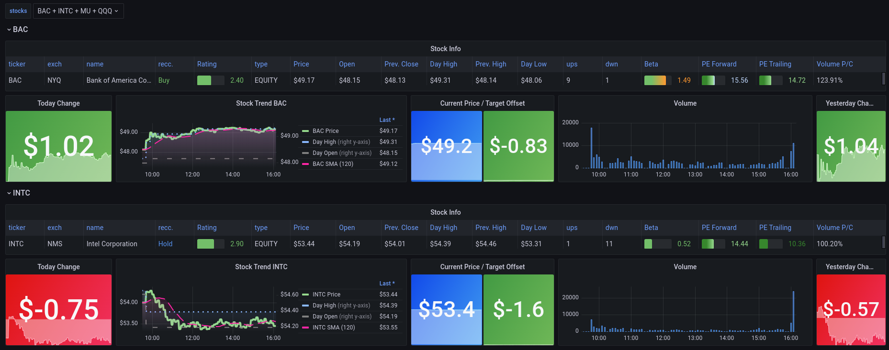

# finance-exporter
finance-exporter polls market and rates data from multiple sources and serves it on a Prometheus metrics endpoint.

Supported sources:

| Plugin | Covers | API key |
|---|---|---|
| `yfinance` (Yahoo Finance) | Stocks, ETFs, mutual funds, indices, FX, crypto, futures | No |
| `fred` (St. Louis Fed) | Treasury yields, credit spreads, policy rates, inflation, mortgage rates, and other economic series | Yes, free: [request one](https://fred.stlouisfed.org/docs/api/api_key.html) |
| `treasury` (Treasury.gov) | Official daily Treasury par yield curves, nominal and real | No |
| `alphavantage` | Stocks (quote, company overview, latest earnings) | Yes. Free tier: 25 requests/day, 3 per ticker |

## Grafana Dashboard Sample
Sample in [Grafana JSON](contrib/finance-exporter.json) with an `asset_class` filter, per-ticker market panels, and a Rates row.


## Configuration
The config file is validated against [schema.yaml](schema.yaml). Sources are independent and metric names must be unique across all sources. Map environment variables for API keys (e.g., `${FRED_API_KEY}`). Full example: [finance-exporter.yaml](finance-exporter.yaml).

**Global Settings**
```yaml
port: 8000
address: 0.0.0.0
metric_prefix: finance
min_interval: 15
```

**Sources**
```yaml
sources:
  - name: yahoo
    interval: 300
    plugin: yfinance
    tickers: [AAPL, SPY, VTSAX, ^GSPC, EURUSD=X, BTC-USD, GC=F]
    metrics:
      ...
    labels:
      ...
```

`tickers` format by plugin:

| Plugin | Tickers | Example |
|---|---|---|
| `yfinance` | Yahoo symbols | `AAPL`, `SPY`, `^GSPC`, `EURUSD=X`, `BTC-USD`, `GC=F` |
| `fred` | FRED series IDs | `DGS10`, `T10Y2Y`, `BAMLH0A0HYM2`, `MORTGAGE30US` |
| `treasury` | Tenors on the curve | `3M`, `2Y`, `10Y`, `30Y` (the real curve has 5Y–30Y only) |
| `alphavantage` | Stock symbols | `IBM` |

*Note:* The `treasury` plugin accepts `curve: nominal` (default) or `curve: real`. Add two sources to export both.

**Metrics**
`item` is the response field. Optional `scale` multiplies the value (e.g., `0.01`). Non-numeric values are skipped.
```yaml
    metrics:
      current_price:
        item: regularMarketPrice
        type: Gauge
        help: Current Market Price of Asset
      expense_ratio:
        item: netExpenseRatio
        type: Gauge
        help: Net Expense Ratio (ratio)
        scale: 0.01
```

| Plugin | Fields |
|---|---|
| `yfinance` | Everything in Yahoo's quote. ETFs and mutual funds also get `category`, `fundFamily`, `legalType`, `annualReportExpenseRatio`, `annualHoldingsTurnover` and asset mix (`stockPosition`, `bondPosition`, ...). Yahoo mixes percents and ratios, so check each field. |
| `fred` | `value`, `observation_time`, `title`, `frequency`, `units` |
| `treasury` | `value`, `observation_time`, `curve` |
| `alphavantage` | Quote fields (`price`, `volume`, ...), company overview fields, latest quarterly earnings |

| Plugin | `asset_class` values |
|---|---|
| `yfinance` | `stock`, `etf`, `mutual_fund`, `index`, `fx`, `crypto`, `future` |
| `fred` | `rate` (series measured in percent), otherwise `economic_indicator` |
| `treasury` | `treasury_yield` |
| `alphavantage` | `stock`, `etf`, `mutual_fund` |

**Observation time**
`observation_time` (FRED and Treasury) is the data date as a Unix timestamp at midnight UTC. Use it to alert on stale values:
```
time() - finance_fred_observation_time{ticker="DGS10"} > 4 * 86400
```

**Labels**
Map label names to source fields. `plugin`, `source` and `ticker` are added automatically.
```yaml
    labels:
      asset_class: asset_class
      name: shortName
      sector: sector
      category: category
```

### Migrating from older configs
* Move the top-level `tickers` list into each source's `tickers`.
* Delete `update_cache_on_startup`. Labels are no longer shared between sources.
* Replace `iexcloud` sources (shut down August 2024). Yahoo's `regularMarketPrice` and `regularMarketVolume` replace `current_price` and `volume`.
* Write AlphaVantage's plugin name as `alphavantage`.

## Running the exporter
Install dependencies (`pip3 install -r requirements.txt`) and run. Use `docker-compose` to run via Docker, passing env vars like `FRED_API_KEY`. 

**Script Options**
```bash
usage: finance-exporter.py [-h] -f CONFIG [-v] [-p PORT] [-a ADDRESS] [-d]

Finance Prometheus Exporter

optional arguments:
  -h, --help            show this help message and exit
  -f CONFIG, --config CONFIG
                        Location of config yaml
  -v, --verbose         Print status to stdout
  -p PORT, --port PORT  Listening port (ip:port or just port)
  -a ADDRESS, --address ADDRESS
                        Listen address
  -d, --debug           Dump API Data
```

## Tests
```bash
pip3 install -r requirements-dev.txt
pytest tests
```
To re-record API responses to `tests/fixtures`, run `python3 tests/record_fixtures.py`. Set `FRED_API_KEY` to include FRED.
